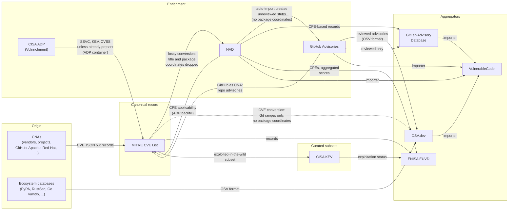

# Vulnerability Database Mesh

Documentation of the public vulnerability databases,
how they interact,
and what happens to a vulnerability record as it travels between them.

Public vulnerability data does not live in one place.
A single vulnerability is typically described by several databases at once:
the CVE List, the NVD, GitHub Advisories, OSV.dev, GitLab,
national databases, and downstream aggregators.
Each database ingests records from the others,
enriches them (or fails to),
and republishes them.
The result is a *mesh* of data flows
in which information is added, lost, or corrupted at every hop.

This repository documents:

- **[The databases](databases/README.md)**:
  one page per database, in a comparable format,
  describing what it covers,
  where its data comes from,
  what it adds,
  and its known data-quality issues.
- **[Case studies](case-studies/README.md)**:
  concrete examples of a record traveling through the mesh,
  showing exactly where the data degraded.

## The mesh at a glance

Reading convention:
an arrow `A --> B` means *data flows from A into B*.
Edge labels describe what is transferred, added, or lost on that hop.
A dashed arrow marks a flow that is partial or unreliable in practice.

## Why this matters

The same vulnerability can look completely different
depending on which database a tool reads.
The seed case study, [CVE-2026-50628](case-studies/cve-2026-50628-cxf.md),
affects exactly one Maven artifact
(`org.apache.cxf:cxf-rt-rs-security-oauth2`, CVSS 9.8),
yet:

- MITRE has correct Maven coordinates,
- NVD attached a CPE covering the entire Apache CXF product (dozens of artifacts),
- the GitHub advisory is an empty, unreviewed stub two months after disclosure,
- GitLab has no record at all, and
- OSV mixes the good MITRE data with the bad NVD CPE.

A scanner keyed on NVD massively over-reports;
one keyed on GitLab misses a 9.8 entirely.
Understanding the mesh is a prerequisite
for understanding (and fixing) this class of failure.

## Databases covered

| Database                 | Operator            | Page                                                                           |
|--------------------------|---------------------|--------------------------------------------------------------------------------|
| MITRE CVE List           | MITRE (CVE Program) | [databases/mitre-cve.md](databases/mitre-cve.md)                               |
| NVD                      | NIST                | [databases/nvd.md](databases/nvd.md)                                           |
| GitHub Advisory Database | GitHub              | [databases/github-advisories.md](databases/github-advisories.md)               |
| OSV.dev                  | Google / OpenSSF    | [databases/osv.md](databases/osv.md)                                           |
| GitLab Advisory Database | GitLab              | [databases/gitlab-advisory-database.md](databases/gitlab-advisory-database.md) |
| CISA KEV                 | CISA                | [databases/cisa-kev.md](databases/cisa-kev.md)                                 |
| ENISA EUVD               | ENISA               | [databases/euvd.md](databases/euvd.md)                                         |
| VulnerableCode           | AboutCode           | [databases/vulnerablecode.md](databases/vulnerablecode.md)                     |

## Contributing

See [CONTRIBUTING.md](CONTRIBUTING.md).
New database pages and case studies are welcome;
templates are provided in each directory.

## License

Documentation in this repository is licensed under
[CC-BY-4.0](LICENSE).
