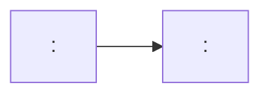

# <Identifier>: <short title>

<One-paragraph summary:
what the vulnerability is,
what went wrong in the mesh,
and the practical consequence for consumers.>

## The record

| | |
|---|---|
| **Identifiers** | <CVE, GHSA, other aliases> |
| **Affected** | <precise coordinates, e.g. a PURL> |
| **Severity** | <CVSS> |
| **Disclosed** | <date> |
| **Source issue / discussion** | <link> |

## Timeline

| Date | Database | Event |
|---|---|---|
| <date> | <db> | <what happened, with a permalink to the record state> |

## State per database

| Database | State | What is wrong |
|---|---|---|
| [<db>](../databases/<page>.md) | <what the record says> | <the defect, or "nothing"> |

## The record's journey

<Annotate where degradation happened and why.>

## Lessons

- <what this case demonstrates about the mesh>

## Sources

- <permalinked record states, issues, discussions>
