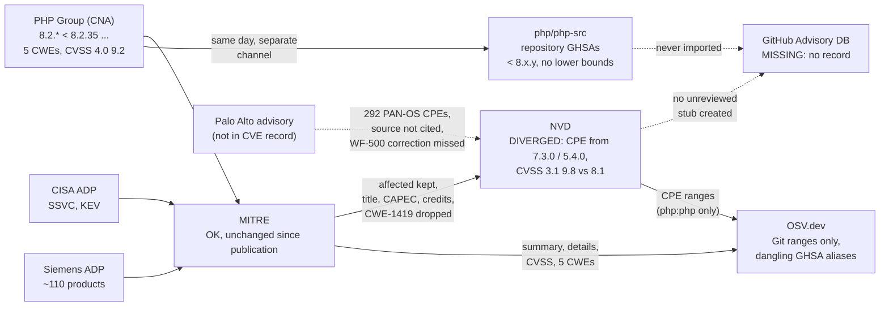

# CVE-2026-109618 and CVE-2026-109619 (PHP2Shell): field by field

"PHP2Shell" is the name given to two remote code execution flaws in the PHP interpreter,
CVE-2026-109618 (memory corruption after an out-of-memory `longjmp()`)
and CVE-2026-109619 (stale global state reused across requests),
disclosed together on October 21, 2026
and added to CISA KEV five days later.
The PHP Group is its own CNA.
It published both CVE records in one batch,
with the same structure, the same affected ranges, the same CVSS vector and the same CWE list,
and has not touched its CNA container since.
That makes the pair a controlled experiment:
any difference between the two records downstream
was introduced by a downstream database, not by the source.

This case study follows every field of the CNA record
into NVD, GitHub and OSV.dev,
and records whether each field was copied as is, transformed, dropped, or supplemented.
In summary:

- **NVD** now keeps the CNA's `affected` block from the first ingest,
  which is an improvement over [CVE-2026-50628](cve-2026-50628-cxf.md).
  It still drops the title, the CAPEC, the credits and the workarounds,
  and it silently drops one of the five CWEs.
  Its own analysis then changed what the CNA said in three places:
  the version ranges were widened back to PHP 7.3.0 and 5.4.0
  (a different lower bound for each of the twin CVEs),
  a CVSS 3.1 score was added that disagrees between the twins,
  and 292 Palo Alto PAN-OS CPEs were added from a vendor advisory
  that the NVD record does not cite.
- **GitHub** has no global advisory for either CVE, reviewed or unreviewed.
  The GHSA IDs that the CVE records cite
  are repository advisories in `php/php-src`
  that never entered the GitHub Advisory Database.
- **OSV.dev** copies the CNA's text fields faithfully.
  Its version ranges come from NVD's CPEs rather than from the CNA,
  so it inherits NVD's widened lower bounds,
  and it lists as aliases two GHSA IDs that OSV itself cannot resolve.

## The record

| | |
|---|---|
| **Identifiers** | CVE-2026-109618, CVE-2026-109619; repository advisories GHSA-w8hw-w9fx-j79w, GHSA-6wmf-4rv5-p3rp (php/php-src only) |
| **Affected (CNA)** | PHP (`packageName: php-src`): `8.2.* < 8.2.35`, `8.3.* < 8.3.36`, `8.4.* < 8.4.27`, `8.5.* < 8.5.12`, `defaultStatus: unaffected` |
| **Severity (CNA)** | CVSS 4.0 9.2, `AV:N/AC:H/AT:P/PR:N/UI:N/VC:H/VI:H/VA:H/SC:N/SI:N/SA:N` (both) |
| **Disclosed** | October 21, 2026 |
| **Exploitation** | CISA KEV, both added October 26, 2026 |
| **Record format** | CVE JSON 5.x, authored in Vulnogram 1.0.5; no `packageURL`, no `collectionURL`, no `cpeApplicability` |
| **Source issue / discussion** | [GHSA-w8hw-w9fx-j79w](https://github.com/php/php-src/security/advisories/GHSA-w8hw-w9fx-j79w), [GHSA-6wmf-4rv5-p3rp](https://github.com/php/php-src/security/advisories/GHSA-6wmf-4rv5-p3rp) |

## Timeline

All times UTC.
Unless one CVE is named, an event applies to both.

| Date | Database | Event |
|---|---|---|
| 2026-10-21 13:34 | GitHub (repository) | PHP publishes repository advisories GHSA-w8hw-w9fx-j79w and GHSA-6wmf-4rv5-p3rp in `php/php-src`, each with four ranges of the form `< 8.x.y` and no lower bounds |
| 2026-10-21 13:48 / 13:54 | [MITRE](../databases/mitre-cve.md) | CVE records published by the `php` CNA ([CVE-2026-109618](https://github.com/CVEProject/cvelistV5/blob/5af786420c20314e43305693ca1dae85d522ff3d/cves/2026/109xxx/CVE-2026-109618.json), [CVE-2026-109619](https://github.com/CVEProject/cvelistV5/blob/6613c3f8a296cf2a9bffaa4eb0c54103d3e72e4b/cves/2026/109xxx/CVE-2026-109619.json)); the CNA container is byte-identical to the current one except `providerMetadata` |
| 2026-10-21 14:17 | [NVD](../databases/nvd.md) | Records received with description, CVSS 4.0 (Secondary), the `affected` pass-through and **four of the five CWEs**: CWE-1419 is missing from the first version onward ([mirror state](https://github.com/fkie-cad/nvd-json-data-feeds/blob/d04819dd67f268a6aa8b2ae67613bb9fce0983b3/CVE-2026/CVE-2026-1096xx/CVE-2026-109618.json)) |
| 2026-10-21 15:17 | [MITRE](../databases/mitre-cve.md) → [NVD](../databases/nvd.md) | CISA ADP adds SSVC (`Exploitation: active`) and a reference; NVD mirrors both |
| 2026-10-21 16:00 | Palo Alto Networks | Vendor advisory "Impact of Critical Vulnerabilities in PHP (CVE-2026-109618, CVE-2026-109619) on Palo Alto Networks Products", published under the [CVE-2026-109618 URL](https://security.paloaltonetworks.com/CVE-2026-109618) only; not added to the CVE record as an ADP or reference |
| 2026-10-21 17:00 | [NVD](../databases/nvd.md) | Initial Analysis, under four hours after publication: `cpe:2.3:a:php:php` with the first range **unbounded below** (`up to (excluding) 8.2.35`), and a Primary CVSS 3.1 vector `AC:L`, 9.8, on both CVEs ([mirror state](https://github.com/fkie-cad/nvd-json-data-feeds/blob/d523b42e49869f583804d8e2716f8c6b86d2a2e4/CVE-2026/CVE-2026-1096xx/CVE-2026-109618.json)) |
| 2026-10-22 20:45 | [NVD](../databases/nvd.md) | CVE-2026-109619 only: CVSS 3.1 changed to `AC:H`, 8.1 ([mirror state](https://github.com/fkie-cad/nvd-json-data-feeds/blob/b3ab6c3d91c4aa2519bbd4c858382e1339bad9a6/CVE-2026/CVE-2026-1096xx/CVE-2026-109619.json)); CVE-2026-109618 keeps `AC:L`, 9.8 |
| 2026-10-23 13:22 | [NVD](../databases/nvd.md) | CVE-2026-109619: the open-ended range becomes `[5.4.0, 8.2.35)` ([mirror state](https://github.com/fkie-cad/nvd-json-data-feeds/blob/b920d4e3c0620d397858aac223df55b73b40fae5/CVE-2026/CVE-2026-1096xx/CVE-2026-109619.json)) |
| 2026-10-23 14:17 | [MITRE](../databases/mitre-cve.md) → [NVD](../databases/nvd.md) | Siemens adds a supplier ADP container listing 110 (109618) / 111 (109619) Siemens products with their affected or unaffected status; NVD passes it through as a second `affected` entry |
| 2026-10-23 16:06 / 16:26 | [NVD](../databases/nvd.md) | Modified Analysis adds **292 PAN-OS CPEs** plus Panorama and WildFire WF-500 hardware configurations to both CVEs; CVE-2026-109618's range becomes `[7.3.0, 8.2.35)` ([mirror state 109618](https://github.com/fkie-cad/nvd-json-data-feeds/blob/01e028d81378d3c70f39d030daae602a498e4d3c/CVE-2026/CVE-2026-1096xx/CVE-2026-109618.json), [109619](https://github.com/fkie-cad/nvd-json-data-feeds/blob/01e028d81378d3c70f39d030daae602a498e4d3c/CVE-2026/CVE-2026-1096xx/CVE-2026-109619.json)) |
| 2026-10-23 17:10 | Palo Alto Networks | Advisory timeline: "made the correction to the status of WildFire Appliance WF-500 and WF-500-B impact"; the advisory now lists WF-500 as unaffected. NVD's WF-500 configuration, added 44 minutes earlier, is never removed |
| 2026-10-26 | [CISA KEV](../databases/cisa-kev.md) | Both CVEs added to KEV; recorded in the CISA ADP container ([cvelistV5 state](https://github.com/CVEProject/cvelistV5/blob/b1663d90b7346fd56bb80cd384ef56ee7a8cf5b8/cves/2026/109xxx/CVE-2026-109618.json)) |
| 2026-10-27 01:00 | [NVD](../databases/nvd.md) | KEV fields (`cisaExploitAdd`, `cisaActionDue`, `cisaVulnerabilityName: PHP Memory Corruption Vulnerability`) added ([mirror state](https://github.com/fkie-cad/nvd-json-data-feeds/blob/f77adcc01f41bc2c83fc315c7740027bde2cd0c5/CVE-2026/CVE-2026-1096xx/CVE-2026-109618.json)) |
| 2026-11-02 | [NVD](../databases/nvd.md) | Siemens ADP products converted to CPE configurations ([mirror state](https://github.com/fkie-cad/nvd-json-data-feeds/blob/0478b93a359a5f99d7ba2e4ed5f3b8120f61f1aa/CVE-2026/CVE-2026-1096xx/CVE-2026-109618.json)) |
| 2026-11-11 | [OSV.dev](../databases/osv.md) | Last modification of the converted records ([CVE-2026-109618](https://osv.dev/vulnerability/CVE-2026-109618), [CVE-2026-109619](https://osv.dev/vulnerability/CVE-2026-109619)) |
| as of 2026-11-13 | [GitHub](../databases/github-advisories.md) | No global advisory, reviewed or unreviewed, for either CVE: `GET /advisories?cve_id=…` returns nothing for every `type`, and `github.com/advisories/GHSA-w8hw-w9fx-j79w` returns 404 |

## Field by field

Legend:
**=** copied verbatim,
**≈** copied with a change of form,
**Δ** content changed,
**+** added by this database,
**−** dropped.
"GitHub" here means the global GitHub Advisory Database;
the `php/php-src` repository advisories are the CNA's own publication channel
and are compared separately [below](#the-advisories-that-are-not-in-the-advisory-database).

| CNA field | CNA value | NVD | GitHub | OSV.dev |
|---|---|---|---|---|
| `title` | "RCE via OOM corruption" / "RCE via stale global state" | **−** (no title field) | **−** (no record) | **=** `summary` |
| `descriptions` | English text | **=** plus **+** a Spanish translation (2026-10-22) | **−** | **=** `details` |
| `affected[].vendor/product/packageName` | PHP Group / PHP / `php-src` | **=** in the `affected` pass-through; **Δ** re-expressed as `cpe:2.3:a:php:php` for matching | **−** | **−** no `package`; **≈** only a `GIT` range on `https://github.com/php/php-src` |
| `affected[].versions` | `8.2.* < 8.2.35` … `8.5.* < 8.5.12`, `defaultStatus: unaffected` | **=** in pass-through; **Δ** in CPE: first range starts at 7.3.0 (109618) or 5.4.0 (109619), not 8.2.0 | **−** | **Δ** Git commits derived from NVD's CPE ranges (`source: CPE_RANGE`), so 7.3.0 / 5.4.0 lower bounds |
| `metrics` CVSS 4.0 | 9.2, identical on both | **≈** Secondary, vector expanded with every optional metric set to `X`; **+** Primary CVSS 3.1: 9.8 (109618), 8.1 (109619) | **−** | **=** |
| `problemTypes` CWE | CWE-416, 755, 824, 1325, 1419 | **Δ** CWE-1419 dropped since first ingest | **−** | **=** all five |
| `impacts` CAPEC | CAPEC-234 | **−** | **−** | **−** |
| `credits` | 4 reporters/finders, 4 remediation developers | **−** | **−** | **−** |
| `workarounds` | "Check the GitHub Security Advisory for mitigation strategies." | **−** | **−** | **−** |
| `references` | 1 (the repository advisory) | **=** plus **+** reference tags (`Mitigation`, `Vendor Advisory`); ADP references merged in | **−** | **=** plus ADP and NVD references, **+** links back to cvelistV5 and NVD |
| CISA ADP SSVC / KEV | `Exploitation: active`; KEV 2026-10-26 | **≈** `ssvcV203` metric and `cisa*` fields | **−** | **−** KEV only as a plain `WEB` reference |
| Siemens supplier ADP | 110 / 111 Siemens products | **=** second `affected` pass-through entry; **+** Siemens CPE configurations (2026-11-02) | **−** | **−** |
| *(not in the CVE record)* | Palo Alto advisory | **+** 292 PAN-OS CPEs, Panorama and WF-500 configurations, no reference to the source | **−** | **−** (ignored when extracting CPE ranges) |
| `cveMetadata` aliases | — | — | — | **+** `aliases`: the two repository GHSA IDs and three Bitnami IDs; **+** `related`: AlmaLinux and SUSE advisories |

Read down the NVD column:
NVD keeps the CNA's data in two layers that disagree with each other.
The `affected` pass-through is a faithful copy of the CNA.
The CPE `configurations`, which is what CPE-keyed scanners actually match on,
contains NVD's own version ranges, NVD's own product list and NVD's own CVSS.
Read down the OSV column:
OSV copies the CNA's prose and scores exactly,
but builds its machine-readable `affected` section from NVD's layer, not the CNA's.

## What NVD had to change, and what it changed anyway

Some NVD changes were necessary,
because the CNA record cannot be consumed by CPE-keyed tools as published:

- **The CNA gives no CPE and no PURL.**
  `packageName: php-src` with no `collectionURL` names no ecosystem,
  so some product identifier had to be chosen.
  `cpe:2.3:a:php:php` is the obvious one.
- **The CNA's version syntax is not machine-comparable.**
  `"version": "8.2.*"` with `"versionType": "semver"` is not a valid semantic version.
  The intended meaning, "from 8.2.0, less than 8.2.35", is clear to a human.
  NVD translated it correctly for 8.3, 8.4 and 8.5
  (`from (including) 8.3.0 up to (excluding) 8.3.36`, and so on).

Other changes go beyond what the CNA stated:

- **Lower bounds outside the CNA's statement.**
  The CNA declares `defaultStatus: unaffected`,
  which means PHP 8.1 and earlier are stated to be unaffected.
  NVD first dropped the lower bound of the 8.2 range altogether,
  so every PHP version ever released matched.
  Two days later it set the bound to 7.3.0 for CVE-2026-109618
  and to 5.4.0 for CVE-2026-109619.
  Neither bound appears in the CNA record, in the repository advisories,
  or in any reference attached to the NVD record,
  and NVD's change history records no rationale.
  The bounds may well be technically right for end-of-life branches,
  but they are NVD's claims, presented in the field that consumers read as the record.
- **The twin CVSS 3.1 scores diverged.**
  The CNA's CVSS 4.0 vectors are identical and both use `AC:H`.
  NVD scored both `AC:L`, 9.8,
  then corrected only CVE-2026-109619 to `AC:H`, 8.1, a day later.
  The NVD Primary score for CVE-2026-109618 still contradicts
  the CNA's attack complexity.
- **Products from an uncited source.**
  The 292 PAN-OS CPEs match Palo Alto's advisory,
  which the CNA did not reference and which Palo Alto did not submit as an ADP container.
  NVD applied it to both CVE records
  but did not add it to either record's references,
  so the record gives no way to trace where those CPEs came from.
  The configuration also marks PAN-OS on WildFire WF-500 / WF-500-B appliances as vulnerable.
  Palo Alto corrected the WF-500 status at 17:10 on October 23,
  44 minutes after NVD's analysis,
  and NVD has not updated it since.
  By contrast, the Siemens products came in through an ADP container in the CVE record
  and are traceable.
- **A CWE vanished.**
  CWE-1419 ("Incorrect Initialization of Resource")
  is the only one of the CNA's five CWEs missing from NVD,
  from the first ingested version onward.
  The change history shows four "Added CWE" entries and no removal,
  so the CWE was dropped at import.
  The reason is not recorded.

## The advisories that are not in the Advisory Database

The PHP Group published each vulnerability twice:
as a GitHub repository advisory in `php/php-src` at 13:34,
and as a CVE record from Vulnogram 14 to 20 minutes later.
The two publications agree on the title, the CVSS 4.0 vector and all five CWEs,
but not on the version ranges:

| | CVE record | Repository advisory |
|---|---|---|
| 8.2 branch | `8.2.*`, `lessThan: 8.2.35` | `< 8.2.35`, patched `8.2.35` |
| 8.5 branch | `8.5.*`, `lessThan: 8.5.12` | `< 8.5.12`, patched `8.5.12` |
| Lower bounds | Implied by the `8.x.*` wildcard | None |

The repository advisory lists four overlapping ranges against one package
(ecosystem `php`, name `php-src`).
Their union is simply `< 8.5.12`,
which also covers patched releases such as 8.2.35.

Neither repository advisory ever reached the global GitHub Advisory Database.
Unlike [CVE-2026-50628](cve-2026-50628-cxf.md) and CVE-2025-68161,
GitHub's NVD import did not create even an unreviewed stub.
`php-src` is not a package in any ecosystem that GitHub's dependency graph covers,
so there was nothing for review to attach the advisory to,
and the records do not show why the unreviewed import was skipped.
The consequences reach past GitHub:

- the CVE records' only CNA reference is a GHSA URL
  that resolves to the repository's security tab,
  not to `github.com/advisories`;
- OSV lists both GHSA IDs as `aliases`,
  but `api.osv.dev/v1/vulns/GHSA-w8hw-w9fx-j79w` returns 404,
  so the alias points to nothing in OSV itself.

## The record's journey

What each hop did:

1. **MITRE** kept the CNA container unchanged
   and gained three ADP containers (CISA, CVE Program, Siemens).
   Nothing was lost at this hop.
2. **MITRE → NVD** is no longer the near-total loss seen in June 2026:
   the `affected` block arrived with the first ingest.
   The title, CAPEC, credits and workarounds still have no NVD field,
   and CWE-1419 disappeared without explanation.
3. **NVD analysis** was fast (under four hours) and productive,
   but it rewrote the CNA's ranges beyond what the CNA stated,
   scored the twin CVEs differently,
   and imported a third-party product list without citing it.
4. **GitHub** contributed nothing to the global database,
   although the CNA published its own advisories on GitHub first.
5. **OSV.dev** carried the CNA's text faithfully,
   but took its ranges from NVD's CPE layer.
   This exports NVD's lower bounds as Git commit ranges
   (for example `introduced: 76b580d8`, the PHP 5.4.0 release commit, for CVE-2026-109619)
   and makes no use of the Siemens or Palo Alto CPEs.

## Lessons

- The twin records isolate NVD's analyst variance.
  Identical CNA inputs, analyzed on the same day,
  produced different CVSS 3.1 scores and different version ranges.
  When the source is identical, every difference downstream is noise added downstream.
- NVD's `affected` pass-through and its CPE configuration can contradict each other
  in the same record.
  A consumer has to choose which layer to trust,
  and the CPE layer, which scanners read, is the one that departs from the CNA.
- A third-party advisory used in analysis should become a reference.
  Here NVD's largest addition, 292 PAN-OS CPEs, cannot be traced from the record itself,
  and it was frozen at a version of the vendor advisory that the vendor corrected within the hour.
  Siemens shows the traceable alternative: a supplier ADP container.
- A CNA publishing on GitHub is not the same as GitHub publishing an advisory.
  For software outside the package ecosystems, such as language runtimes,
  the GHSA ID is a repository-local identifier,
  and other databases that alias it inherit an identifier that does not resolve in them.
- Imprecise CNA syntax (`8.2.*` as a semver) forces every consumer to re-derive the ranges,
  and each consumer re-derives them differently.
  A `cpeApplicability` block, or a `versionType` with real lower bounds,
  would have given NVD and OSV less room to diverge.

## Sources

- MITRE record history:
  <https://github.com/CVEProject/cvelistV5/commits/main/cves/2026/109xxx/CVE-2026-109618.json>,
  <https://github.com/CVEProject/cvelistV5/commits/main/cves/2026/109xxx/CVE-2026-109619.json>
- NVD record history (mirror):
  <https://github.com/fkie-cad/nvd-json-data-feeds/commits/main/CVE-2026/CVE-2026-1096xx/CVE-2026-109618.json>,
  <https://github.com/fkie-cad/nvd-json-data-feeds/commits/main/CVE-2026/CVE-2026-1096xx/CVE-2026-109619.json>;
  change histories:
  <https://nvd.nist.gov/vuln/detail/CVE-2026-109618#VulnChangeHistorySection>,
  <https://nvd.nist.gov/vuln/detail/CVE-2026-109619#VulnChangeHistorySection>
  (also `services.nvd.nist.gov/rest/json/cvehistory/2.0?cveId=…`)
- PHP repository advisories:
  <https://github.com/php/php-src/security/advisories/GHSA-w8hw-w9fx-j79w>,
  <https://github.com/php/php-src/security/advisories/GHSA-6wmf-4rv5-p3rp>
- GitHub Advisory Database queries (empty as of 2026-11-13):
  `GET https://api.github.com/advisories?cve_id=CVE-2026-109618&type=reviewed|unreviewed|malware`,
  same for CVE-2026-109619
- OSV records:
  <https://osv.dev/vulnerability/CVE-2026-109618>,
  <https://osv.dev/vulnerability/CVE-2026-109619>
- Palo Alto Networks advisory, including its timeline of status corrections:
  <https://security.paloaltonetworks.com/CVE-2026-109618>
  (machine-readable: <https://security.paloaltonetworks.com/json/CVE-2026-109618>)
- Siemens advisories cited by the Siemens ADP:
  <https://cert-portal.siemens.com/productcert/html/ssa-566512.html>,
  <https://cert-portal.siemens.com/productcert/html/ssa-166980.html>,
  <https://cert-portal.siemens.com/productcert/html/ssa-566435.html>
