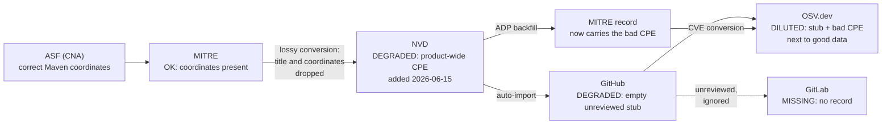

# CVE-2026-50628: one Maven artifact, four contradictory databases

CVE-2026-50628 is a CVSS 9.8 vulnerability
affecting exactly one Maven artifact,
`pkg:maven/org.apache.cxf/cxf-rt-rs-security-oauth2`,
not the Apache CXF codebase as a whole.
The CNA record at MITRE carries correct Maven coordinates.
Two months after disclosure,
NVD describes it with a CPE covering the entire CXF product
(dozens of artifacts),
the GitHub advisory is an empty unreviewed stub,
GitLab has no record at all,
and OSV mixes the good and the bad data.
Depending on which database a scanner reads,
it either massively over-reports,
reports correctly,
or misses a critical vulnerability entirely.

Documented from
[aboutcode-org/vulnerablecode#2409](https://github.com/aboutcode-org/vulnerablecode/issues/2409)
(reported by @pombredanne with details from @ppkarwasz).

## The record

| | |
|---|---|
| **Identifiers** | CVE-2026-50628, GHSA-g5v7-jchf-7jrr |
| **Affected** | `pkg:maven/org.apache.cxf/cxf-rt-rs-security-oauth2` only |
| **Severity** | CVSS 9.8 |
| **Disclosed** | June 12, 2026 |
| **Source issue** | [vulnerablecode#2409](https://github.com/aboutcode-org/vulnerablecode/issues/2409) |

## Timeline

| Date | Database | Event |
|---|---|---|
| 2026-06-12 | [MITRE](../databases/mitre-cve.md) | CVE published by the CNA with Maven coordinates in the record ([cvelistV5 record](https://github.com/CVEProject/cvelistV5/blob/main/cves/2026/50xxx/CVE-2026-50628.json), [cve.org](https://www.cve.org/CVERecord?id=CVE-2026-50628)) |
| 2026-06-12 | [NVD](../databases/nvd.md) | Initial NVD record nearly empty: the lossy conversion from the CVE format keeps the description and references but drops the title and the Maven coordinates ([mirror state](https://github.com/fkie-cad/nvd-json-data-feeds/blob/bde8d216748790cf40fc461aa9e9351dd7c06e96/CVE-2026/CVE-2026-506xx/CVE-2026-50628.json)) |
| 2026-06-12 | [GitHub](../databases/github-advisories.md) | GHSA-g5v7-jchf-7jrr auto-created from the NVD record as an unreviewed stub: no title, no artifact, no affected ranges |
| 2026-06-15 | [NVD](../databases/nvd.md) | Analysis adds the **incorrect, product-wide CPE** `cpe:2.3:a:apache:cxf`, covering dozens of artifacts instead of the one affected package ([mirror state, line 49](https://github.com/fkie-cad/nvd-json-data-feeds/blob/c8e589f587fe50f16712ebc10079e4fde00a1210/CVE-2026/CVE-2026-506xx/CVE-2026-50628.json#L49)) |
| 2026-06-17 | [NVD](../databases/nvd.md) | Re-sync restores the CNA data, including the Maven `packageName`, into the `affected` pass-through field, and a `nvd@nist.gov` Primary CVSS 9.8 appears; the CPE that scanners match on stays wrong ([mirror state](https://github.com/fkie-cad/nvd-json-data-feeds/blob/644f9fc5bd0a10688470dc004d55d76098d99f56/CVE-2026/CVE-2026-506xx/CVE-2026-50628.json)) |
| later | [NVD](../databases/nvd.md) | Red Hat adds CPE-keyed, VEX-like statements about whether its larger products are affected ([mirror state](https://github.com/fkie-cad/nvd-json-data-feeds/blob/2dd45b48e0efa0fde64742f95da829dc45ea506c/CVE-2026/CVE-2026-506xx/CVE-2026-50628.json)) |
| 2026-08 | [GitHub](../databases/github-advisories.md) | Two months after disclosure, the advisory is still an empty stub ([advisory-database state](https://github.com/github/advisory-database/blob/dbc1435941d42e394de655b8e344b1aab124a9a4/advisories/unreviewed/2026/06/GHSA-g5v7-jchf-7jrr/GHSA-g5v7-jchf-7jrr.json)) |

## State per database (as of August 2026)

| Database | State | What is wrong |
|---|---|---|
| [MITRE CVE List](../databases/mitre-cve.md) | Maven coordinates properly provided, at least in the package name | Nothing at the CNA level; but the NVD ADP backfill attaches the bad CPE to the canonical record |
| [NVD](../databases/nvd.md) | Record with `cpe:2.3:a:apache:cxf` | CPE covers the whole CXF product; CPE-keyed scanners flag dozens of unaffected artifacts. The correct `packageName` sits unused in the `affected` pass-through field |
| [GitHub Advisories](../databases/github-advisories.md) | [GHSA-g5v7-jchf-7jrr](https://github.com/advisories/GHSA-g5v7-jchf-7jrr), unreviewed | Empty stub, imported from the NVD record that had already lost the coordinates: no title, no package, no ranges, despite CVSS 9.8 |
| [GitLab Advisory Database](../databases/gitlab-advisory-database.md) | No record | GitLab ignores unreviewed GHSA advisories, so its users get no alert at all |
| [OSV.dev](../databases/osv.md) | [CVE-2026-50628](https://osv.dev/vulnerability/CVE-2026-50628) | Merges the GitHub stub with the MITRE record that was backfilled with the incorrect NVD CPE, diluting the data further |

## The record's journey

Degradation happened at four points along one causal chain:

1. **The lossy MITRE-to-NVD conversion** dropped the CNA's title
   and Maven coordinates at ingest,
   leaving the NVD record nearly empty.
2. **NVD review** restored product data only at CPE granularity,
   as a too-broad, product-wide CPE
   (CPE cannot express Maven artifacts).
   The June 17 re-sync brought the Maven coordinates back
   into the `affected` pass-through field,
   which CPE-keyed consumers ignore,
   and the ADP backfill then wrote the bad CPE
   into the canonical CVE record.
3. **GitHub's auto-import from NVD** created a stub
   from a record that no longer had any package coordinates,
   and no human review followed,
   even though the CNA container one hop upstream
   contained everything needed to curate it.
4. **GitLab's filtering policy**
   turned GitHub's curation gap into a total coverage gap.

## Lessons

- A correct CNA record protects almost no downstream consumer:
  the very first hop out of the CVE List discards the best data,
  and every later database inherits the loss.
- CPE's product granularity is structurally unable
  to represent single-artifact vulnerabilities
  in multi-artifact projects;
  any CPE-keyed consumer over-reports.
- Backfill loops
  (NVD into the CVE ADP container, then out to OSV)
  let an error outlive its source
  and contaminate databases that never read NVD directly.
- "We only take reviewed data" policies fail silently:
  the consumer sees nothing
  rather than something flagged as low quality.

## Sources

- Issue: <https://github.com/aboutcode-org/vulnerablecode/issues/2409>
- MITRE record: <https://github.com/CVEProject/cvelistV5/blob/main/cves/2026/50xxx/CVE-2026-50628.json>
- NVD record history (fkie-cad mirror): <https://github.com/fkie-cad/nvd-json-data-feeds/commits/main/CVE-2026/CVE-2026-506xx/CVE-2026-50628.json>
- GitHub advisory: <https://github.com/advisories/GHSA-g5v7-jchf-7jrr>
- OSV record: <https://osv.dev/vulnerability/CVE-2026-50628>
