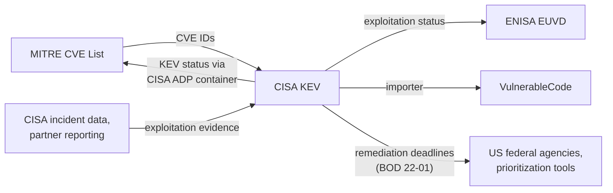

# CISA KEV (Known Exploited Vulnerabilities Catalog)

The KEV catalog is not a general-purpose vulnerability database
but a curated subset:
CVEs for which CISA has evidence of active exploitation in the wild.
Its value in the mesh is the exploitation signal itself,
which many downstream tools and policies
(including US federal remediation deadlines)
key on.

## At a glance

|                       |                                                                |
|-----------------------|----------------------------------------------------------------|
| **Operator**          | CISA (US Cybersecurity and Infrastructure Security Agency)     |
| **URL**               | <https://www.cisa.gov/known-exploited-vulnerabilities-catalog> |
| **Identifier scheme** | `CVE-YYYY-NNNNN` (entries are keyed by CVE ID)                 |
| **Data format**       | JSON and CSV feed with a small fixed schema                    |
| **Data license**      | US government work, freely usable                              |
| **Access**            | Bulk JSON/CSV download, updated as entries are added           |

## Scope

Only vulnerabilities with a CVE ID
*and* reliable evidence of active exploitation.
A few thousand entries,
versus hundreds of thousands of CVEs.
Absence from KEV is not evidence of non-exploitation.

## Ingests from

- [MITRE CVE List](mitre-cve.md) / [NVD](nvd.md):
  the CVE identifier and description the entry is keyed on.
- CISA's own incident data, partner reporting,
  and public exploitation reporting
  (the curation input, external to the mesh).

## Feeds into

- [MITRE CVE List](mitre-cve.md):
  KEV status also reaches CVE records
  through the CISA ADP ("Vulnrichment") container.
- [ENISA EUVD](euvd.md): exploitation status is mirrored.
- [VulnerableCode](vulnerablecode.md):
  via importers, as exploitability evidence.
- Prioritization tooling and policy:
  US federal agencies must remediate KEV entries
  by the listed due date (BOD 22-01);
  many commercial prioritization schemes weight KEV presence.

## Local mesh

## Enrichment performed

- **Exploitation status**: the catalog's reason to exist.
- **Required action and due date** for US federal agencies.
- **Known ransomware campaign use** flag.

## Known data-quality issues

- **Inherits identifier problems from upstream**:
  a KEV entry points at a CVE;
  if the CVE's product mapping is wrong in NVD,
  KEV-driven prioritization inherits the confusion
  about what to actually patch.
- **Evidence threshold creates lag and gaps**:
  exploitation often predates listing by weeks,
  and exploited vulnerabilities without a CVE ID
  cannot be listed at all.
