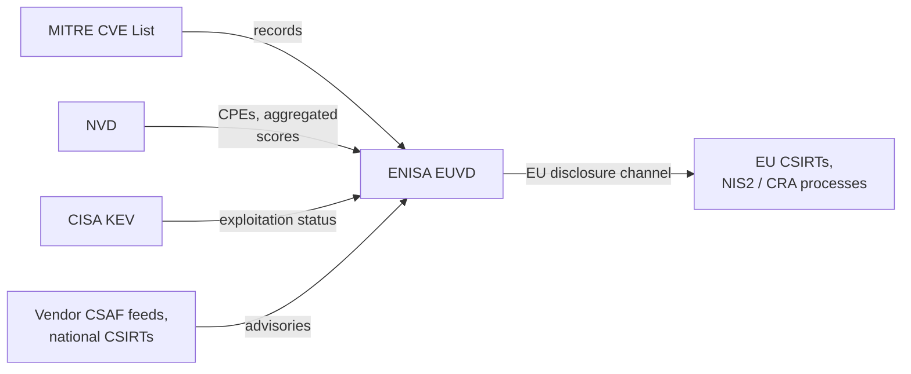

# ENISA EUVD (European Union Vulnerability Database)

The EUVD is the EU's vulnerability database,
operated by ENISA under the NIS2 directive
and publicly launched in May 2025.
It aggregates existing sources
(CVE List, NVD, CISA KEV, vendor advisories)
rather than originating much data,
assigns its own EUVD identifiers alongside CVE IDs,
and serves as the EU's disclosure channel,
including for vulnerabilities reported under the Cyber Resilience Act.
ENISA is also a CNA.

## At a glance

|                       |                                                           |
|-----------------------|-----------------------------------------------------------|
| **Operator**          | ENISA (EU Agency for Cybersecurity)                       |
| **URL**               | <https://euvd.enisa.europa.eu>                            |
| **Identifier scheme** | `EUVD-YYYY-NNNNN`, cross-referenced to CVE and GHSA IDs   |
| **Data format**       | Custom JSON via API; aggregates CVE JSON and CSAF sources |
| **Data license**      | Public EU service; records carry upstream attribution     |
| **Access**            | Web UI and REST API                                       |

## Scope

Publicly known vulnerabilities relevant to the EU market,
in practice mirroring the global CVE corpus,
with additional emphasis on actively exploited
and coordinated-in-EU disclosures.

## Ingests from

- [MITRE CVE List](mitre-cve.md):
  records mirrored and re-keyed with EUVD IDs.
- [NVD](nvd.md):
  CPEs and aggregated scores
  (the CVSS itself originates from CNAs or the CISA ADP).
- [CISA KEV](cisa-kev.md): exploitation status.
- Vendor advisories,
  notably CSAF feeds from European vendors.
- National CSIRTs,
  under NIS2 coordinated disclosure.

## Feeds into

- EU regulatory processes (NIS2, CRA reporting) and European CSIRTs.
- Downstream aggregation is still emerging;
  the database is young.

## Local mesh

## Enrichment performed

- EUVD identifier assignment
  and cross-referencing of upstream IDs.
- Aggregated exploitation flag
  combining KEV and other signals.
- An EU-jurisdiction disclosure channel
  independent of US-funded infrastructure,
  which is itself a form of mesh resilience.

## Known data-quality issues

- **Mostly a mirror today**:
  errors in CVE/NVD data (including over-broad CPEs)
  appear in EUVD unchanged;
  the database adds identifiers faster than it adds curation.
- **Yet another alias**:
  EUVD IDs add one more identifier for the same issue,
  and alias mapping mistakes
  create duplicate or split records downstream.
