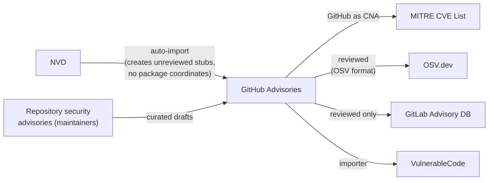

# GitHub Advisory Database

GitHub's advisory database assigns GHSA identifiers
and publishes advisories in OSV format.
It is split into two very different halves:
**reviewed** advisories,
curated by GitHub's security team
with package coordinates and affected ranges for supported ecosystems,
and **unreviewed** advisories,
which are automatic imports of NVD records with no curation at all.
Downstream consumers treat these halves differently,
which shapes much of the mesh.
GitHub is also itself a CNA,
so advisories originating on GitHub flow back into the CVE List.

## At a glance

|                       |                                                                                                                                             |
|-----------------------|---------------------------------------------------------------------------------------------------------------------------------------------|
| **Operator**          | GitHub (Microsoft)                                                                                                                          |
| **URL**               | <https://github.com/advisories>                                                                                                             |
| **Identifier scheme** | `GHSA-xxxx-xxxx-xxxx`, cross-referenced to CVE IDs                                                                                          |
| **Data format**       | OSV schema (JSON)                                                                                                                           |
| **Data license**      | CC-BY-4.0                                                                                                                                   |
| **Access**            | Git repository [`github/advisory-database`](https://github.com/github/advisory-database), GraphQL API (`securityVulnerabilities`), REST API |

## Scope

Reviewed:
open-source packages in the ecosystems GitHub supports
(Maven, npm, PyPI, RubyGems, NuGet, Go, Composer, Rust, Erlang,
GitHub Actions, Swift, ...).
Unreviewed:
every CVE record published by the NVD,
whether or not it maps to a supported package.

## Ingests from

- [NVD](nvd.md):
  every CVE published by the NVD is auto-imported,
  typically within minutes of NVD publication
  (unreviewed advisories carry an `nvd_published_at` timestamp).
  Because the NVD record already lost the CNA's package coordinates and title
  in the lossy MITRE-to-NVD conversion,
  the resulting *unreviewed* stubs start with no software identifiers,
  no matter how precise the original CVE record was.
- Repository security advisories:
  maintainers draft advisories on their own repos;
  GitHub as CNA can assign a CVE,
  making GitHub an origin as well as a consumer.
- Community contributions:
  pull requests against the advisory-database repository.

## Feeds into

- [MITRE CVE List](mitre-cve.md):
  GitHub-as-CNA advisories become CVE records.
- [OSV.dev](osv.md):
  reviewed advisories are ingested wholesale
  (they are already in OSV format).
- [GitLab Advisory Database](gitlab-advisory-database.md):
  reviewed advisories only;
  GitLab deliberately ignores unreviewed ones.
- [VulnerableCode](vulnerablecode.md): via importers.
- Dependabot and the dependency graph:
  GitHub's own alerting consumes only reviewed advisories.

## Local mesh

## Enrichment performed

For **reviewed** advisories:
precise package ecosystem coordinates,
affected and patched version ranges,
severity (CVSS), CWEs,
and human-written summaries.
This is some of the highest-quality package-level data in the mesh.

For **unreviewed** advisories: none.
The stub carries whatever the NVD record had,
often little more than a description and a score.

## Known data-quality issues

- **Unreviewed advisories can stay empty indefinitely**:
  an auto-imported stub may have no title, no affected package, and no ranges,
  even for a CVSS 9.8 issue in a heavily used ecosystem,
  and remain in that state months later.
  See [CVE-2026-50628](../case-studies/cve-2026-50628-cxf.md)
  (GHSA-g5v7-jchf-7jrr).
- **The reviewed/unreviewed split silently partitions downstream visibility**:
  consumers that only take reviewed advisories (GitLab, Dependabot)
  simply do not see unreviewed records,
  so a curation gap at GitHub becomes a coverage gap elsewhere.
- **The import path bypasses the CNA's coordinates**:
  exact Maven coordinates may exist one hop upstream,
  in the CVE record's CNA container,
  but the NVD-based import never sees them;
  only human review restores them.
