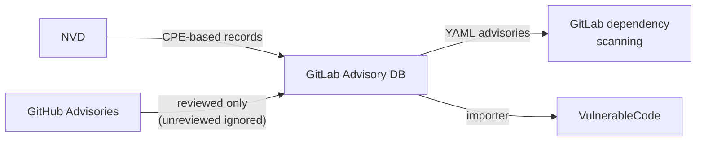

# GitLab Advisory Database

GitLab maintains its own advisory database (historically "gemnasium-db")
to power GitLab dependency scanning.
It curates package-level records from NVD, GitHub, and other sources
into per-package YAML files.
Its filtering policy matters for the mesh:
advisories that GitHub marks *unreviewed* are ignored,
so a curation gap upstream becomes a missing record here.

## At a glance

|                       |                                                                                           |
|-----------------------|-------------------------------------------------------------------------------------------|
| **Operator**          | GitLab                                                                                    |
| **URL**               | <https://gitlab.com/gitlab-org/security-products/gemnasium-db>                            |
| **Identifier scheme** | Per-package paths keyed by ecosystem and package slug; records reference CVE and GHSA IDs |
| **Data format**       | Custom YAML, one file per advisory under `<ecosystem>/<package>/`                         |
| **Data license**      | GitLab EE license terms; free usage restricted (not an open-data license)                 |
| **Access**            | Git repository; consumed by GitLab dependency scanning analyzers                          |

## Scope

Open-source packages
in the ecosystems GitLab dependency scanning supports
(Maven, npm, PyPI, RubyGems, NuGet, Go, Composer, Conan, ...).

## Ingests from

- [NVD](nvd.md):
  CPE-based records,
  mapped to package coordinates by GitLab analysts.
- [GitHub Advisories](github-advisories.md):
  **reviewed advisories only**;
  unreviewed advisories are deliberately skipped.
- Other public sources and GitLab's own analyst research.

## Feeds into

- GitLab dependency scanning (the primary consumer).
- [VulnerableCode](vulnerablecode.md): via importers.

## Local mesh

## Enrichment performed

- Mapping product-level (CPE) records
  to concrete package coordinates and affected version ranges
  in each supported ecosystem.
- Analyst-written solution and description fields.

## Known data-quality issues

- **Coverage gap inherited from GitHub's review queue**:
  because unreviewed GHSA advisories are ignored,
  a vulnerability whose GitHub stub was never curated
  can be entirely absent from GitLab,
  even at CVSS 9.8.
  GitLab users then see no alert at all.
  See [CVE-2026-50628](../case-studies/cve-2026-50628-cxf.md).
- **Restrictive license limits reuse**:
  unlike CC-BY sources,
  the data cannot be freely incorporated into other open databases,
  reducing cross-checking in the mesh.
- **Lag behind upstream corrections**:
  fixes to NVD or GitHub records
  require re-curation to reach the YAML files.
