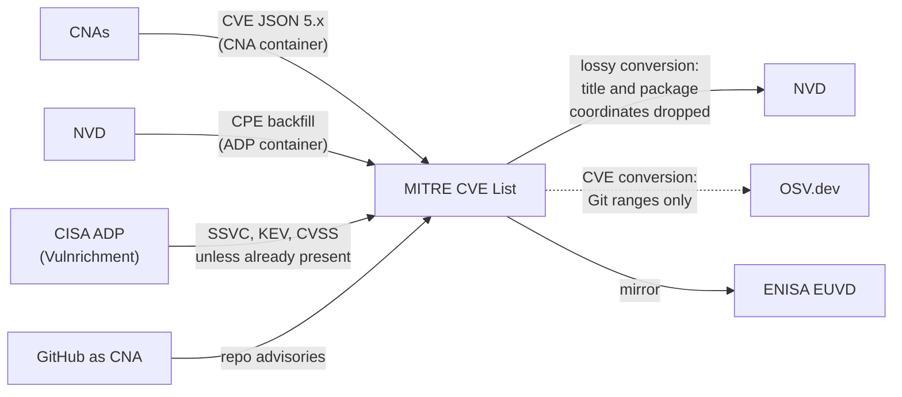

# MITRE CVE List

The CVE List is the canonical registry of CVE identifiers and records,
operated by MITRE as the primary secretariat of the CVE Program (sponsored by CISA).
Records are authored by CVE Numbering Authorities (CNAs),
which are vendors, open-source projects, and research organizations
authorized to assign CVE IDs for their scope.
Nearly every other database in the mesh
is directly or transitively downstream of the CVE List.

## At a glance

|                       |                                                                                                                                        |
|-----------------------|----------------------------------------------------------------------------------------------------------------------------------------|
| **Operator**          | MITRE Corporation, on behalf of the CVE Program                                                                                        |
| **URL**               | <https://www.cve.org>                                                                                                                  |
| **Identifier scheme** | `CVE-YYYY-NNNNN`                                                                                                                       |
| **Data format**       | CVE JSON 5.x (CNA container plus optional ADP containers)                                                                              |
| **Data license**      | CVE Program terms of use (free to use with attribution)                                                                                |
| **Access**            | Git mirror [`CVEProject/cvelistV5`](https://github.com/CVEProject/cvelistV5), CVE Services API (`cveawg.mitre.org`), web UI at cve.org |

## Scope

All publicly disclosed vulnerabilities in any software or hardware, worldwide,
provided a CNA (or MITRE as CNA of last resort) assigns an ID.
Not limited to open source.

## Ingests from

- **CNAs**
  (several hundred, including GitHub, the Apache Software Foundation, Red Hat,
  and most large vendors):
  the authoritative CNA container of each record.
- **ADPs** (Authorized Data Publishers):
  additional containers layered on top of CNA data.
  The CISA-ADP ("Vulnrichment") adds SSVC decisions, KEV status,
  and a CVSS score when one is not already present
  (relevant for CNAs like the ASF
  that publish their own severity scale instead of CVSS).
  The NVD backfills its CPE applicability analysis as another ADP container.
  This means [NVD](nvd.md) mistakes can flow *back* into the canonical record.

## Feeds into

- [NVD](nvd.md):
  every CVE is converted to the NVD API format, **lossily**:
  the title and the CNA's software identifiers
  (`collectionURL`/`packageName`, `packageURL`, CNA-provided CPEs)
  are dropped at ingest.
  Later re-syncs restore the CNA `affected` data into a pass-through field,
  and NVD review re-adds product data, but only at CPE granularity.
- [GitHub Advisories](github-advisories.md):
  only *indirectly*, via [NVD](nvd.md);
  there is no direct import from the CVE List,
  which is why unreviewed advisories lack the coordinates
  present in the CNA container.
- [OSV.dev](osv.md):
  CVE records are converted to OSV format,
  but the conversion emits Git commit ranges without any `package` entry,
  so the results are invisible to package queries.
- [ENISA EUVD](euvd.md):
  records are mirrored and re-keyed with EUVD identifiers.
- [CISA KEV](cisa-kev.md):
  KEV entries are keyed by CVE ID.
- [VulnerableCode](vulnerablecode.md): via importers.

## Local mesh

## Enrichment performed

MITRE itself performs little enrichment;
the value of a record is set by its CNA.
CVE JSON 5.x allows CNAs to express precise package coordinates
in `affected` entries
(`collectionURL`, `packageName`, version ranges),
and quality-focused CNAs such as the ASF use this.
ADP containers add third-party enrichment
(CISA SSVC decisions and CVSS, NVD CPEs)
without altering the CNA container.

## Known data-quality issues

- **CNA quality variance**:
  product identification ranges from precise package coordinates
  to free-text product names,
  depending entirely on the CNA.
- **The best data does not survive export**:
  the CNA's title and package coordinates
  are dropped by the lossy conversion into NVD,
  and NVD is what GitHub and much of the rest of the mesh actually consume.
  Precise CNA data therefore protects almost no downstream consumer.
  See [CVE-2026-50628](../case-studies/cve-2026-50628-cxf.md).
- **ADP backfill can canonicalize errors**:
  incorrect NVD CPE data replicated into the CVE record's ADP container
  is then consumed by downstream converters
  as if it were part of the canonical record.
  See [CVE-2026-50628](../case-studies/cve-2026-50628-cxf.md).
- **No machine-enforced schema for product naming**:
  even in JSON 5.x, `product` and `vendor` are free text,
  so downstream CPE/PURL mapping is guesswork
  unless the CNA provides explicit coordinates.
