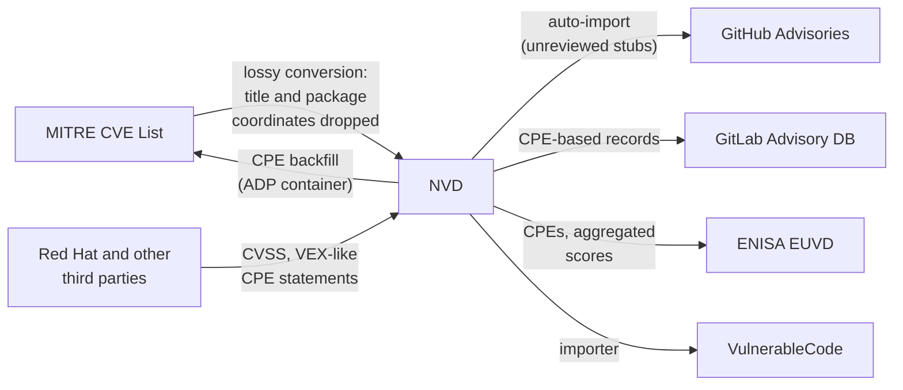

# NVD (National Vulnerability Database)

The NVD is the US government's enrichment layer on top of the CVE List, run by NIST.
It re-publishes every CVE record
and adds the CPE applicability statements most tooling depends on.
A very large share of commercial and open-source scanners
key their matching on NVD CPE data,
which makes NVD errors unusually contagious.

## At a glance

|                       |                                                                                                                                                                                                                     |
|-----------------------|---------------------------------------------------------------------------------------------------------------------------------------------------------------------------------------------------------------------|
| **Operator**          | NIST (National Institute of Standards and Technology)                                                                                                                                                               |
| **URL**               | <https://nvd.nist.gov>                                                                                                                                                                                              |
| **Identifier scheme** | `CVE-YYYY-NNNNN` (same IDs as the CVE List)                                                                                                                                                                         |
| **Data format**       | NVD API 2.0 JSON; applicability expressed as CPE 2.3 match criteria                                                                                                                                                 |
| **Data license**      | US government work, free to use with attribution requested                                                                                                                                                          |
| **Access**            | NVD REST API 2.0 (legacy JSON feeds retired); community git mirrors such as [`fkie-cad/nvd-json-data-feeds`](https://github.com/fkie-cad/nvd-json-data-feeds) and [`olbat/nvdcve`](https://github.com/olbat/nvdcve) |

## Scope

Every published CVE record, all software and hardware.
The NVD adds analysis
but does not assign identifiers or accept direct vulnerability reports.

## Ingests from

- [MITRE CVE List](mitre-cve.md):
  all published records, through a **lossy conversion** to the NVD API format.
  At initial ingest the record keeps little more than
  the description and references:
  the title and the CNA's software identifiers
  (`collectionURL`/`packageName`, `packageURL`, CNA-provided CPEs)
  are dropped.
  Later re-syncs populate an `affected` pass-through field
  that preserves the CNA package coordinates,
  but the `configurations` (CPE) data that scanners match on
  is authored separately by NVD analysts during review.
- Third parties such as Red Hat
  submit CVSS scores and CPE-keyed applicability statements
  (VEX-like "product X is not affected" data)
  that appear in NVD records alongside NIST's own analysis.

## Feeds into

- [MITRE CVE List](mitre-cve.md):
  NVD's CPE analysis is backfilled into CVE records as an ADP container,
  so NVD data re-enters the canonical record.
- [GitHub Advisories](github-advisories.md):
  the auto-import that creates unreviewed advisories pulls from NVD
  (typically within minutes of NVD publication),
  not from the CVE List,
  so the stubs inherit NVD's lack of package coordinates.
- [GitLab Advisory Database](gitlab-advisory-database.md):
  one of GitLab's sources.
- [ENISA EUVD](euvd.md): CPEs and aggregated scores are mirrored.
- [OSV.dev](osv.md):
  indirectly, through the ADP backfill consumed by OSV's CVE conversion.
- [VulnerableCode](vulnerablecode.md): via importers.
- A long tail of scanners and SCA tools that match on CPE.

## Local mesh

## Enrichment performed

- **CPE applicability statements**:
  which products and version ranges are affected,
  expressed in CPE 2.3 and added only when NVD analysts review the record.
  This is the NVD's defining contribution and its biggest liability.
- **CVSS display, no longer CVSS analysis**:
  on recent records the NVD no longer authors its own CVSS scores;
  the scores shown come from the CNA or from the CISA ADP
  ("unless already present" enrichment).
  NIST-authored Primary scores still appeared as late as June 2026
  (for example on CVE-2026-50628).
- **CWE classification** and reference tagging.

## Known data-quality issues

- **The import discards the CNA's package data, and review restores it only as CPE**:
  the lossy conversion drops precise coordinates at ingest,
  and CPE identifies *products* (`cpe:2.3:a:apache:cxf`), not artifacts.
  A vulnerability confined to one Maven module of a multi-module project
  gets a CPE covering every artifact of the product,
  causing mass false positives in CPE-keyed scanners.
  See [CVE-2026-50628](../case-studies/cve-2026-50628-cxf.md),
  where the CNA's precise Maven coordinates
  were replaced by a product-wide CPE.
- **Analysis can go beyond the CNA and leave no trail**:
  CPE ranges may be widened past the CNA's stated bounds,
  identical CNA inputs may receive different NVD CVSS scores,
  and products may be added from third-party advisories
  that are not added to the record's references.
  See [CVE-2026-109618/109619](../case-studies/cve-2026-109618-php2shell.md).
- **Analysis lag and backlog**:
  records can sit "Awaiting Analysis" for extended periods
  (the 2024 backlog being the extreme case),
  during which downstream consumers see empty or partial data.
- **Errors propagate widely and persist**:
  because NVD data is backfilled into CVE ADP containers
  and mirrored by aggregators,
  a wrong CPE keeps circulating even after correction attempts,
  and historical mirrors retain it indefinitely.
- **No PURL support**:
  package-level ecosystems (Maven, npm, PyPI) cannot be precisely addressed
  in the data scanners consume,
  forcing downstream databases to re-derive coordinates.
