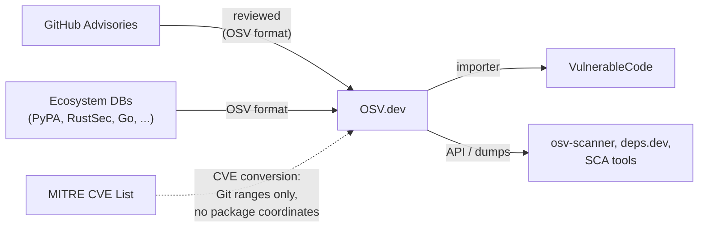

# OSV.dev

OSV.dev is Google's aggregation service built around the OSV schema,
a package-first (PURL and ecosystem-native) vulnerability format.
It aggregates advisories from ecosystem databases and GitHub,
and additionally converts CVE records into OSV format.
Because it merges sources of very different quality under one identifier,
it both improves coverage and dilutes precision.

## At a glance

|                       |                                                                                                        |
|-----------------------|--------------------------------------------------------------------------------------------------------|
| **Operator**          | Google, under the OpenSSF umbrella                                                                     |
| **URL**               | <https://osv.dev>                                                                                      |
| **Identifier scheme** | Source-native IDs (GHSA, PYSEC, RUSTSEC, GO, ...) plus converted `CVE-YYYY-NNNNN`; aliases link them   |
| **Data format**       | OSV schema (JSON)                                                                                      |
| **Data license**      | Aggregated records keep their source licenses; the service and dumps are freely accessible             |
| **Access**            | REST API (`api.osv.dev`), bulk data in the `gs://osv-vulnerabilities` GCS bucket, `osv-scanner` client |

## Scope

Open-source packages,
keyed by ecosystem coordinates and version ranges.
Through CVE conversion it also carries records
that have no package mapping at all.

## Ingests from

- [GitHub Advisories](github-advisories.md):
  reviewed advisories, ingested as-is (already OSV format).
- Ecosystem databases:
  PyPA advisory-db, RustSec, the Go vulnerability database,
  and other OSV-native sources.
- [MITRE CVE List](mitre-cve.md):
  CVE records converted to OSV
  by the `cve-osv-conversion` pipeline,
  **unreliably in practice**.
  The converted records contain Git commit ranges on the upstream repository
  but no `package` entries,
  even when the CNA provided exact Maven coordinates,
  so they cannot be found or matched by package.
  Coverage is also incomplete and lagged:
  of the 72 ASF CVEs disclosed 2026-08-03 to 2026-08-10
  ([apache/security-site#82](https://github.com/apache/security-site/pull/82)),
  spot checks days later found records
  (for example [CVE-2026-61466](https://osv.dev/vulnerability/CVE-2026-61466),
  package-less)
  as well as CVEs missing entirely (CVE-2026-44630).
  The conversion consumes the full CVE record *including ADP containers*,
  which is how [NVD](nvd.md) CPE data enters OSV.

## Feeds into

- [VulnerableCode](vulnerablecode.md): via importers.
- `osv-scanner`, deps.dev,
  and a growing set of SCA tools that prefer package-native data.

## Local mesh

## Enrichment performed

- Normalization of heterogeneous sources
  into one schema and one query surface.
- Alias resolution:
  linking GHSA, ecosystem, and CVE identifiers for the same issue.
- Version-range evaluation service:
  given a package version,
  the API answers whether it is affected,
  using ecosystem-aware version semantics.

OSV.dev deliberately performs little content curation of its own;
record quality is inherited from sources.

## Known data-quality issues

- **CVE conversion produces package-less records**:
  converted CVE records carry Git commit ranges but no `package` entries,
  so package-coordinate queries cannot find them
  and SCA matching cannot use them,
  even when the CNA published precise coordinates.
  Coverage is additionally spotty and lagged
  (see the [apache/security-site#82](https://github.com/apache/security-site/pull/82)
  examples above).
- **Source dilution under one CVE ID**:
  the converted CVE record and the GitHub advisory for the same issue
  can disagree;
  when the CVE record was backfilled with an incorrect NVD CPE,
  OSV republishes that error next to better data,
  and consumers cannot easily tell which side to trust.
  See [CVE-2026-50628](../case-studies/cve-2026-50628-cxf.md).
- **Garbage in, garbage out by design**:
  OSV.dev's no-curation stance means upstream errors
  (empty GHSA stubs, broad CPEs)
  flow through unfiltered.
- **Alias graphs can mislead**:
  records aliased together may describe different affected ranges,
  and downstream dedup logic picks one arbitrarily.
