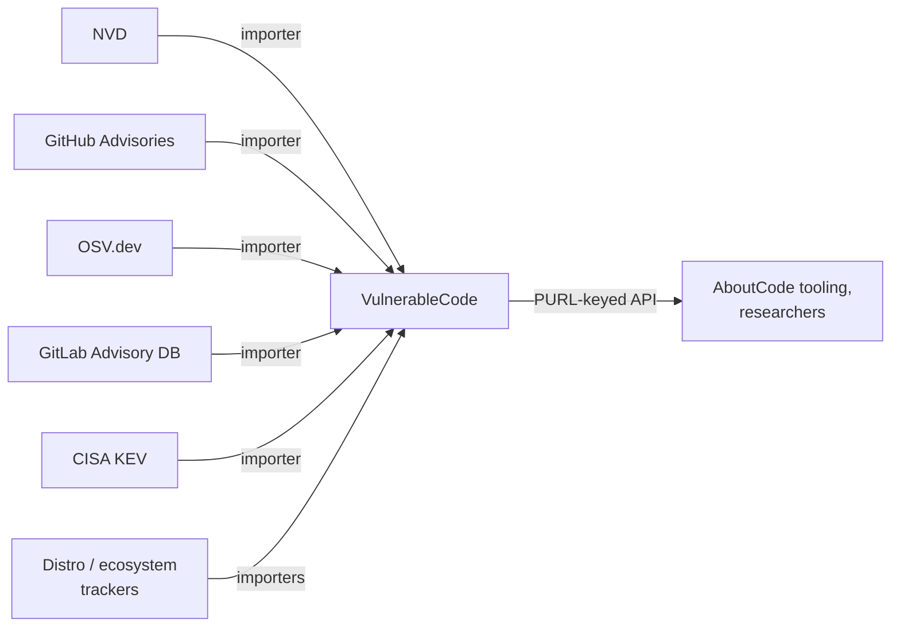

# VulnerableCode

VulnerableCode, by the AboutCode project (nexB),
is an open aggregator
that imports from essentially every other database in the mesh
and correlates records around Package URLs (PURLs).
Its explicit goal is to expose and reconcile
the disagreements between sources
rather than pick one.
The motivating issue for this repository,
[aboutcode-org/vulnerablecode#2409](https://github.com/aboutcode-org/vulnerablecode/issues/2409),
was filed against this project.

## At a glance

|                       |                                                                                               |
|-----------------------|-----------------------------------------------------------------------------------------------|
| **Operator**          | AboutCode / nexB, community-driven                                                            |
| **URL**               | <https://public.vulnerablecode.io>, code at <https://github.com/aboutcode-org/vulnerablecode> |
| **Identifier scheme** | Internal `VCID`, correlated with CVE, GHSA, and source-native IDs; packages keyed by PURL     |
| **Data format**       | Relational model exposed over a REST API; PURL-centric                                        |
| **Data license**      | Data under CC-BY-SA-4.0; code under Apache-2.0                                                |
| **Access**            | Public instance API, self-hostable                                                            |

## Scope

Open-source package vulnerabilities
across all ecosystems it has importers for,
which is most of the public mesh
plus Linux distribution trackers.

## Ingests from

- [NVD](nvd.md), [MITRE CVE List](mitre-cve.md):
  CVE records and analysis.
- [GitHub Advisories](github-advisories.md), [OSV.dev](osv.md),
  [GitLab Advisory Database](gitlab-advisory-database.md):
  package-level advisories.
- [CISA KEV](cisa-kev.md): exploitation evidence.
- Distribution and ecosystem trackers
  (Debian, Alpine, Arch, npm, PyPA, ...)
  not yet covered by dedicated pages here.

## Feeds into

- SCA and compliance tooling built on AboutCode
  (ScanCode.io and others).
- Researchers comparing source disagreement;
  VulnerableCode is effectively a measurement instrument
  for the rest of the mesh.

## Local mesh

## Enrichment performed

- **PURL normalization**:
  every affected package is expressed as a Package URL,
  making records comparable across sources.
- **Improvers**:
  post-import pipelines that add or correct data
  (for example inferring fixed versions, validating ranges)
  with provenance kept per source.
- **Cross-source correlation**:
  the same vulnerability seen by five sources
  becomes one entity with five attributions,
  making disagreements queryable instead of hidden.

## Known data-quality issues

- **Aggregator's dilemma**:
  when sources disagree
  (precise CNA Maven coordinates versus a product-wide NVD CPE),
  automatic reconciliation must choose or expose both;
  either answer can mislead a naive consumer.
  See [CVE-2026-50628](../case-studies/cve-2026-50628-cxf.md).
- **Importer freshness varies**:
  each source has its own sync cadence,
  so the correlated view can mix record versions
  from different points in time.
